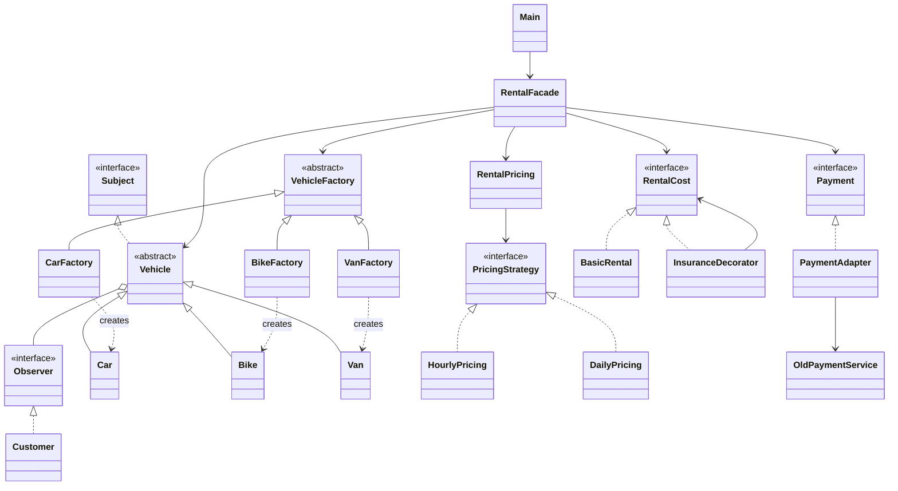
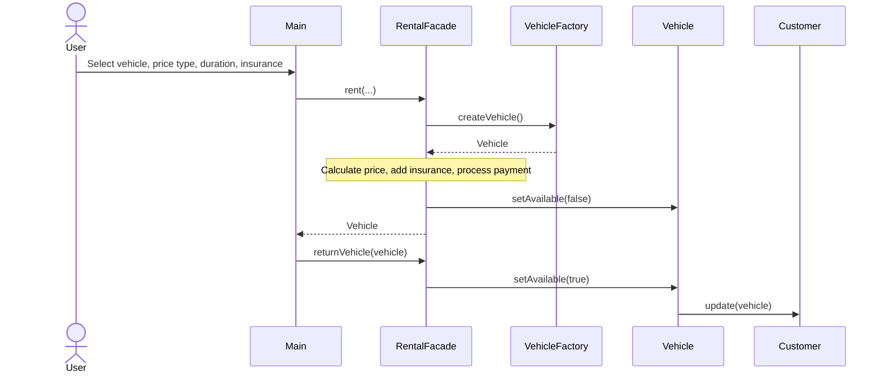

# Vehicle Rental Service

This is our Java console project for renting cars, bikes and vans. We used six design patterns in one program.

## Team

- Nurgissa Pernebay - Factory Method, Facade
- Abish Adil - Observer, Strategy
- Adilgereyev Nuraly - Adapter, Decorator

## Design Patterns

- **Factory Method** - `CarFactory`, `BikeFactory` and `VanFactory` create vehicles.
- **Observer** - `Customer` gets a message when a vehicle is available again.
- **Strategy** - `HourlyPricing` and `DailyPricing` calculate the rental price.
- **Decorator** - `InsuranceDecorator` adds 500 if the user chooses insurance.
- **Adapter** - `PaymentAdapter` connects `Payment` with `OldPaymentService`.
- **Facade** - `RentalFacade` brings all the rental steps together.

## UML Class Diagram



## UML Sequence Diagram



## How to Run

You need Java JDK. Open a terminal in the project folder and run:

```bash
mkdir -p out
javac -d out Main.java Vehicle.java factory/*.java observer/*.java strategy/*.java decorator/*.java adapter/*.java facade/*.java
java -cp out src.Main
```

The program asks for a vehicle, hourly or daily pricing, duration and insurance. Payment is simulated in the console, and the vehicle is returned at the end of the demo.
