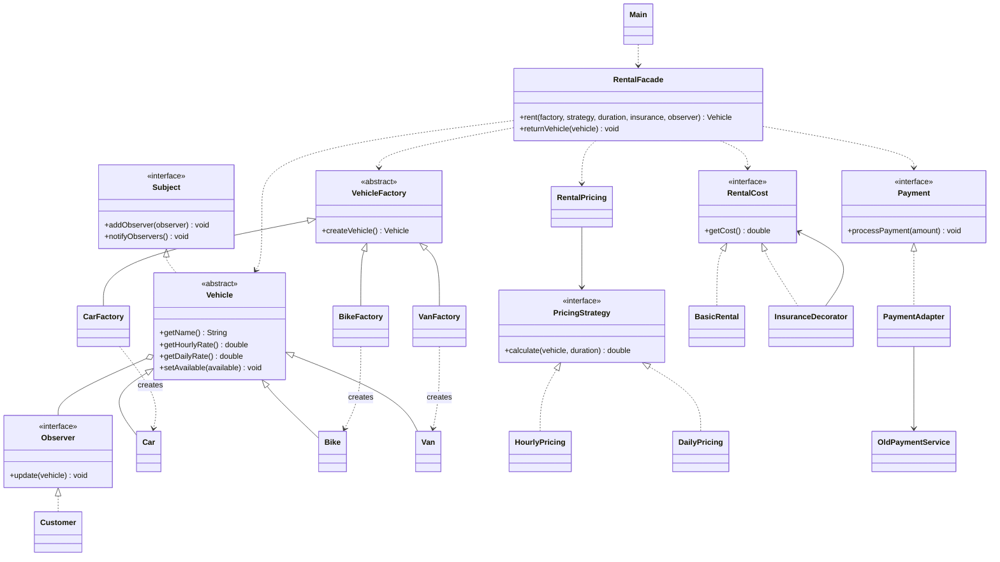
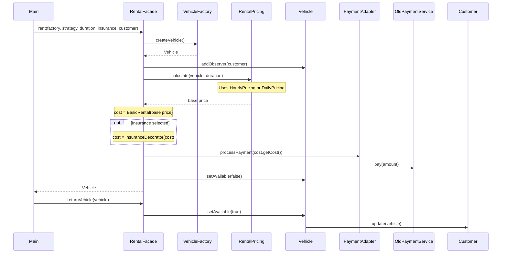

# Vehicle Rental Service

Java console project for renting cars, bikes and vans. We used six design patterns for vehicle creation, pricing, insurance, payment and notifications.

## Team

- Nurgissa Pernebay - Factory Method, Facade
- Abish Adil - Observer, Strategy
- Adilgereyev Nuraly - Adapter, Decorator

## Design Patterns

- **Factory Method** - `CarFactory`, `BikeFactory` and `VanFactory` create vehicles.
- **Observer** - `Vehicle` notifies `Customer` when it becomes available again.
- **Strategy** - `HourlyPricing` and `DailyPricing` calculate different rental prices.
- **Decorator** - `InsuranceDecorator` adds 500 to the base price.
- **Adapter** - `PaymentAdapter` connects `Payment` to `OldPaymentService`.
- **Facade** - `RentalFacade` connects all the rental steps.

## How It Works

The user selects a vehicle, hourly or daily pricing, duration and insurance. `RentalFacade` creates the vehicle, calculates the total and processes a simulated payment. For the demo, the vehicle is returned immediately and `Customer` receives a notification.

## UML Class Diagram



## UML Sequence Diagram



## How to Run

You need Java JDK. Open a terminal in the project folder and run:

```bash
mkdir -p out
javac -d out Main.java Vehicle.java factory/*.java observer/*.java strategy/*.java decorator/*.java adapter/*.java facade/*.java
java -cp out src.Main
```

## Example

Input: `1` (Car), `2` (Daily), `2` days, `1` (Insurance).

Output: `Paid: 12500.0`, then `Linsh: Car is available again`.
