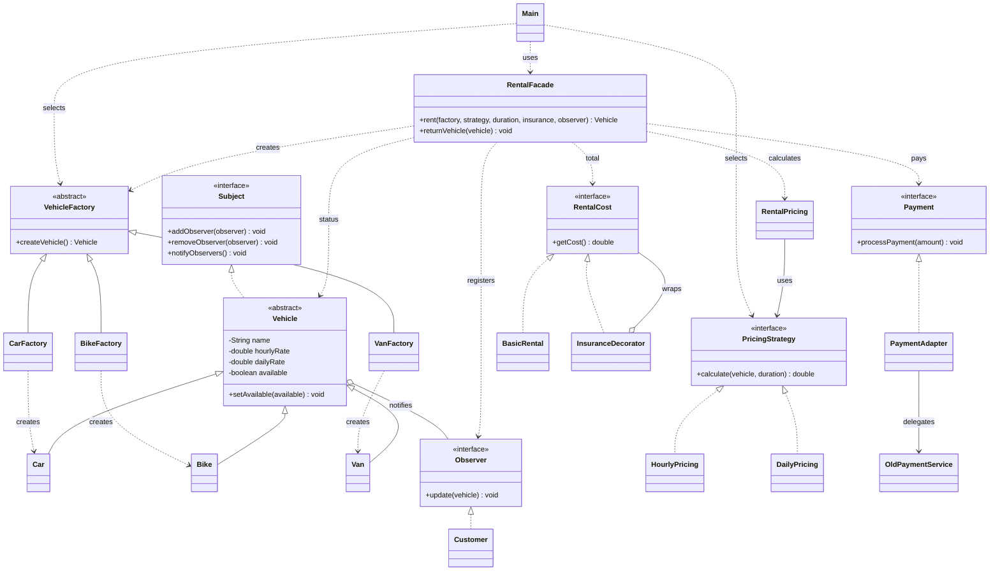
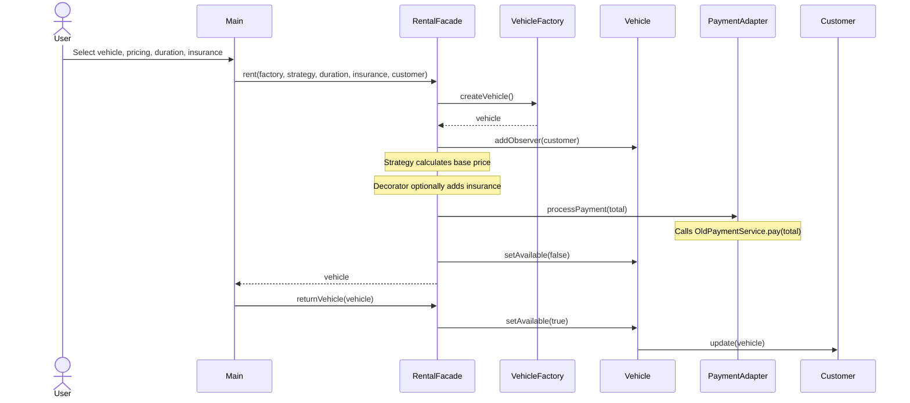

[README.md](https://github.com/user-attachments/files/34434733/README.md)

# Vehicle Rental Service

A Java console application demonstrating six integrated design patterns in a vehicle rental workflow. Users select a car, bike, or van, choose hourly or daily pricing, enter a duration, and optionally add insurance.

## Team Members

| Member | Design Patterns |
| --- | --- |
| Nurgissa Pernebay | Factory Method, Facade |
| Abish Adil | Observer, Strategy |
| Adilgereyev Nuraly | Adapter, Decorator |

## Design Patterns

| Pattern | Main Classes | Purpose |
| --- | --- | --- |
| Factory Method | `VehicleFactory`, `CarFactory`, `BikeFactory`, `VanFactory` | Creates the selected vehicle. |
| Observer | `Subject`, `Observer`, `Vehicle`, `Customer` | Notifies the customer when a vehicle becomes available again. |
| Strategy | `PricingStrategy`, `HourlyPricing`, `DailyPricing`, `RentalPricing` | Calculates the rental price per hour or day. |
| Decorator | `RentalCost`, `BasicRental`, `InsuranceDecorator` | Adds 500 to the rental price if insurance is selected. |
| Adapter | `Payment`, `PaymentAdapter`, `OldPaymentService` | Connects the rental payment interface to the old payment service. |
| Facade | `RentalFacade` | Coordinates creation, pricing, insurance, payment, and return. |

## Rental Workflow

1. The selected factory creates a `Car`, `Bike`, or `Van`.
2. `RentalPricing` uses `HourlyPricing` or `DailyPricing` to calculate the base price.
3. `InsuranceDecorator` adds 500 if insurance is requested.
4. `PaymentAdapter` calls `OldPaymentService`, which **simulates payment** by printing the amount.
5. `RentalFacade` marks the vehicle unavailable. `Main` then returns it immediately for demonstration, triggering the `Customer` observer's notification.

## UML Class Diagram



## UML Sequence Diagram



## Project Structure

```text
Main.java           Console entry point
Vehicle.java        Base vehicle and Observer subject
factory/            Factory Method
observer/           Observer
strategy/           Strategy
decorator/          Decorator
adapter/            Adapter
facade/             Facade
```

## How to Run

Install a **Java JDK** (`javac` and `java` must be available). From the repository folder on macOS or Linux:

```bash
mkdir -p out
javac -d out Main.java Vehicle.java factory/*.java observer/*.java strategy/*.java decorator/*.java adapter/*.java facade/*.java
java -cp out src.Main
```

Example inputs: **Car** (`1`), **Daily** (`2`), duration **2**, insurance **Yes** (`1`). The simulated payment is `12500.0` (`6000 × 2 + 500`) and the customer receives a message when the car becomes available again.
